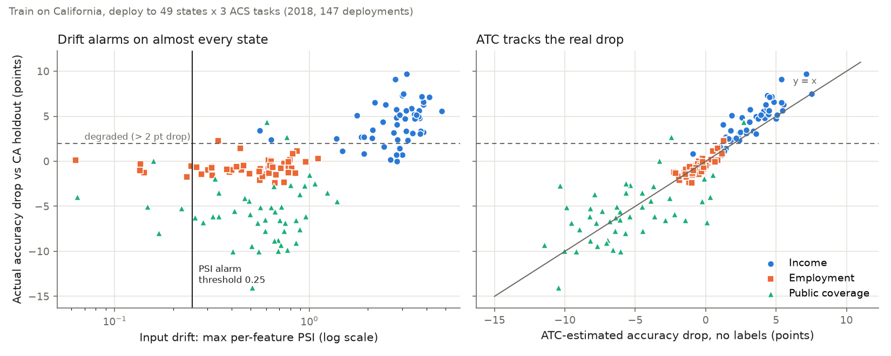

# ML Sentinel: is input drift a useful alarm for model degradation?

[](https://github.com/krishdef7/ml-sentinel/actions/workflows/ci.yml)

**Headline results.** I trained on California and deployed unchanged to the other 49 US states, for 3 ACS
prediction tasks: 147 deployments and 5.27M test rows (2018 census data, via [folktables](https://github.com/socialfoundations/folktables)).
- **Standard drift alarms fire almost everywhere.** KS > 0.1 alarmed on 102 of the 103 deployments whose
  accuracy did *not* drop, and PSI > 0.25 on 92 of 103.
- **Drift barely tracks the damage.** Within each task, the rank correlation between drift and the actual
  accuracy drop is −0.14 to 0.05 for KS and 0.05 to 0.42 for PSI.
- **A label-free confidence estimate does track it.** ATC (average thresholded confidence) flagged 35 of the 44
  degraded deployments with **0 false alarms in 103**. It estimates the accuracy drop with a mean absolute error
  of **1.3 points**, and its within-task rank correlation with the real drop is 0.55–0.89.



Every number above comes from [`experiments/folktables_benchmark.py`](experiments/folktables_benchmark.py).
The per-deployment rows are in [`results/folktables_2018.csv`](results/folktables_2018.csv) and the summary in
[`results/folktables_2018_summary.json`](results/folktables_2018_summary.json).

## Setup

| | |
|---|---|
| Data | ACS 2018 1-Year person records, all 50 states |
| Tasks | `ACSIncome`, `ACSEmployment`, `ACSPublicCoverage` (folktables definitions) |
| Model | `HistGradientBoostingClassifier`, trained on 70% of California. The other 30% is the in-distribution holdout |
| Deployment | the same model, scored on each of the other 49 states (147 deployments) |
| "Degraded" | accuracy more than 2 points below the CA holdout (44 of 147: 41 income, 1 employment, 2 public coverage) |
| Signals (no labels) | max per-feature KS and PSI vs CA train; drop in mean confidence; ATC-estimated accuracy drop |
| Thresholds | fixed before the run: KS 0.10, PSI 0.25, confidence and ATC drop 0.02 |

The state-code feature in the public-coverage task is excluded from drift scoring, because it would alarm
on every deployment by construction.

## Results

| Signal | Alarms on degraded (44) | Alarms on not degraded (103) | AUROC [95% CI] | Spearman vs drop (pooled) |
|---|---|---|---|---|
| KS drift > 0.10 | 44 | **102** | 0.86 [0.78, 0.93] | 0.52 |
| PSI drift > 0.25 | 44 | **92** | 0.92 [0.86, 0.97] | 0.62 |
| Mean-confidence drop > 0.02 | 20 | 0 | 0.98 [0.95, 1.00] | 0.93 |
| **ATC-estimated drop > 0.02** | **35** | **0** | **0.98 [0.95, 1.00]** | **0.93** |

**Read the pooled AUROC for drift with care.** Income is both the task that drifts most and the task that
degrades most (left panel), so pooled drift AUROC partly measures *which task*, not *which deployment*. Within a
task the picture is clearer:

| Spearman with actual accuracy drop | KS | PSI | Mean confidence | ATC |
|---|---|---|---|---|
| Income (41/49 degraded) | 0.03 | 0.42 | 0.90 | 0.89 |
| Employment (1/49) | 0.05 | 0.16 | 0.67 | 0.81 |
| Public coverage (2/49) | −0.14 | 0.05 | 0.55 | 0.55 |

What this shows:
- Across states, *something* in P(X) always moves (birthplace codes, occupation mix), so a drift alarm tells you
  the input changed, not that the model got worse. Many public-coverage deployments drift and get **more**
  accurate.
- Raw mean confidence is conservative here (20/44): the model is under-confident relative to its accuracy drop.
  ATC calibrates a threshold on the holdout and catches 35/44 with no false alarms.
- **Limits:** one model family, one source state, one year, and a 2-point "degraded" cutoff. ATC's largest
  single miss is 7.6 points, so it is an estimate, not a substitute for periodic labels.

## Reproduce

```bash
pip install -e ".[experiments]"
python experiments/folktables_benchmark.py --data-dir data/acs   # downloads ~0.7 GB of census zips once, ~15 min CPU
python experiments/make_figures.py
pytest tests/
```

The run is deterministic (seed 42) and resumable: it appends to the results CSV and skips finished deployments.

## Library

```python
from ml_sentinel import ks_drift, psi_drift, SentinelMonitor, atc_threshold, atc_accuracy

t = atc_threshold(model.predict_proba(X_val), y_val)      # fit on labeled in-distribution data
est_acc = atc_accuracy(model.predict_proba(X_prod), t)    # estimate on unlabeled production data

drift = psi_drift(X_train, X_prod)                        # max per-feature PSI
```

`src/ml_sentinel/` also has Wasserstein, MMD and chi-square drift, ECE, and bootstrap/correlation helpers.
[`paper/theoretical_framework.md`](paper/theoretical_framework.md) has notes on why drift and degradation can
separate (concept shift vs benign covariate shift).

## Credits

ATC is from Garg et al., *Leveraging Unlabeled Data to Predict Out-of-Distribution Performance* (ICLR 2022).
Data and task definitions are from Ding et al., *Retiring Adult* (NeurIPS 2021) / folktables.

MIT License.
